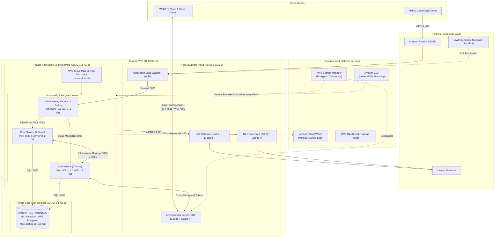

# ScanCall High-Availability Cloud Infrastructure

Comprehensive architecture specification, network design, and deployment runbook for the high-availability cloud infrastructure running on AWS.

---

## 1. High-Level Architecture Diagram



---

## 2. Infrastructure Sizing & Specifications

| Layer | Component | Sizing & Configuration | Redundancy & High Availability |
| :--- | :--- | :--- | :--- |
| **DNS & Perimeter** | **Route 53 & ACM** | Managed Anycast DNS | Automated SSL/TLS certificate renewal |
| | **Application Load Balancer** | Layer 7 Dual-AZ Ingress | Spans Public Subnet 1 & Public Subnet 2 |
| **Networking** | **NAT Gateways** | Dual NAT Gateways (1 per AZ) with dedicated Elastic IPs | Independent egress routing per AZ (no cross-AZ outage impact) |
| **Media Server** | **LiveKit Server** | EC2 `t3.large` (2 vCPU, 8 GB RAM) + Dedicated EIP | Ubuntu 22.04 LTS, Docker host, systemd recovery |
| **Microservices** | **API Gateway Service** | 2 Tasks &times; (512 CPU units / 1024 MB RAM) | Auto-spread across AZ-1 and AZ-2 on AWS Fargate |
| | **Core Service** | 2 Tasks &times; (1024 CPU units / 2048 MB RAM) | Auto-spread across AZ-1 and AZ-2 on AWS Fargate |
| | **Call Service** | 2 Tasks &times; (1024 CPU units / 2048 MB RAM) | Auto-spread across AZ-1 and AZ-2 on AWS Fargate |
| | **Service Discovery** | AWS Cloud Map Private DNS (`scancall.local`) | SRV/A record resolution within VPC |
| **Persistence** | **Amazon RDS PostgreSQL** | `db.t3.medium` (PostgreSQL 18, GP3 20–100 GB) | 7-day retention, automated snapshots, deletion protection |
| **Security** | **Secrets Manager** | AES-256 KMS Encrypted Secrets | Auto-rotation, no secrets committed to codebase |

---

## 3. Network Architecture & Subnet Topology

The VPC uses a non-overlapping CIDR partition distributed symmetrically across two Availability Zones (`eu-west-1a` and `eu-west-1b`):

```
VPC CIDR: 10.0.0.0/16
│
├── Public Subnets (Internet Route via IGW)
│   ├── AZ-1: 10.0.1.0/24  ── ALB (Port 80/443), NAT Gateway 1, LiveKit EC2
│   └── AZ-2: 10.0.2.0/24  ── ALB (Port 80/443), NAT Gateway 2
│
├── Private Application Subnets (Egress via NAT Gateways)
│   ├── AZ-1: 10.0.10.0/24 ── ECS Fargate Tasks (API Gateway, Core, Call)
│   └── AZ-2: 10.0.11.0/24 ── ECS Fargate Tasks (API Gateway, Core, Call)
│
└── Private Data Subnets (Isolated — No Internet Ingress or Egress)
    ├── AZ-1: 10.0.20.0/24 ── RDS PostgreSQL Primary
    └── AZ-2: 10.0.21.0/24 ── RDS Subnet Group
```

---

## 4. Security Group Matrix

Strict least-privilege firewall rules isolate each tier:

| Security Group | Permitted Inbound Traffic | Source / Boundary |
| :--- | :--- | :--- |
| **`alb`** | TCP `80`, `443` | `0.0.0.0/0` (Internet) |
| **`livekit`** | TCP `22` (SSH)<br/>TCP `80` (HTTP)<br/>TCP `443` (HTTPS)<br/>TCP `7880` (Signaling)<br/>TCP `7881` (RTC over TCP)<br/>TCP `7882` (TURN TLS)<br/>UDP `3478` (TURN UDP)<br/>UDP `50000-60000` (Media ICE Range) | `0.0.0.0/0` (Internet / WebRTC Clients) |
| **`api_gateway`** | TCP `8000` | Security Group: `alb` |
| **`core_service`** | TCP `8080` | Security Groups: `api_gateway`, `call_service` |
| **`call_service`** | TCP `8081` | Security Groups: `api_gateway`, `core_service` |
| **`rds`** | TCP `5432` | Security Groups: `core_service`, `call_service` |

---

## 5. Deployment Guide

### Prerequisites
1. **Terraform CLI** (&ge; 1.5.0) installed.
2. **AWS CLI** authenticated with administrative permissions for the target AWS account.
3. **Docker Engine** running locally to push initial images to ECR.

---

### Step 1: Prepare Environment Variables
Create a dedicated variables file, such as `terraform.tfvars`:

```hcl
aws_region   = "eu-west-1"
project_name = "scancall"

# Network & High Availability Configuration
vpc_cidr                  = "10.0.0.0/16"
public_subnet_cidrs       = ["10.0.1.0/24", "10.0.2.0/24"]
private_app_subnet_cidrs  = ["10.0.10.0/24", "10.0.11.0/24"]
private_data_subnet_cidrs = ["10.0.20.0/24", "10.0.21.0/24"]

# Provision dedicated NAT Gateways across both AZs
single_nat_gateway = false

# Custom Domain & SSL
domain_name = "api.yourdomain.com"

# Database Details
db_name            = "scancall_core"
db_master_username = "scancalladmin"
```

---

### Step 2: Initialize & Apply Infrastructure

1. Initialize Terraform providers and backend:
   ```bash
   terraform init
   ```

2. Review the execution plan:
   ```bash
   terraform plan -out=tfplan
   ```

3. Provision the resources:
   ```bash
   terraform apply "tfplan"
   ```

---

### Step 3: Build & Push Container Images to Amazon ECR

Run the automated script to build, tag, push container images, and trigger ECS task rollouts:

**On Windows (PowerShell):**
```powershell
.\scripts\build_and_push.ps1 -Region "eu-west-1"
```

**On Linux/macOS:**
```bash
chmod +x ./scripts/build_and_push.sh
./scripts/build_and_push.sh
```

---

### Step 4: Verification & Health Checks

1. **Application Load Balancer**:
   ```bash
   curl -I https://api.yourdomain.com/health
   ```
2. **LiveKit WebRTC Node**:
   ```bash
   curl -I http://<LIVEKIT_ELASTIC_IP>:7880/
   ```
3. **Database Connectivity**:
   Confirm database credentials stored in Secrets Manager:
   ```bash
   aws secretsmanager get-secret-value --secret-id scancall/db-credentials --region eu-west-1
   ```

